# AlgoVerse

A personal, AI-assisted research and paper-trading desk for Indian index options (Nifty, Bank Nifty and friends), built on the Upstox API.

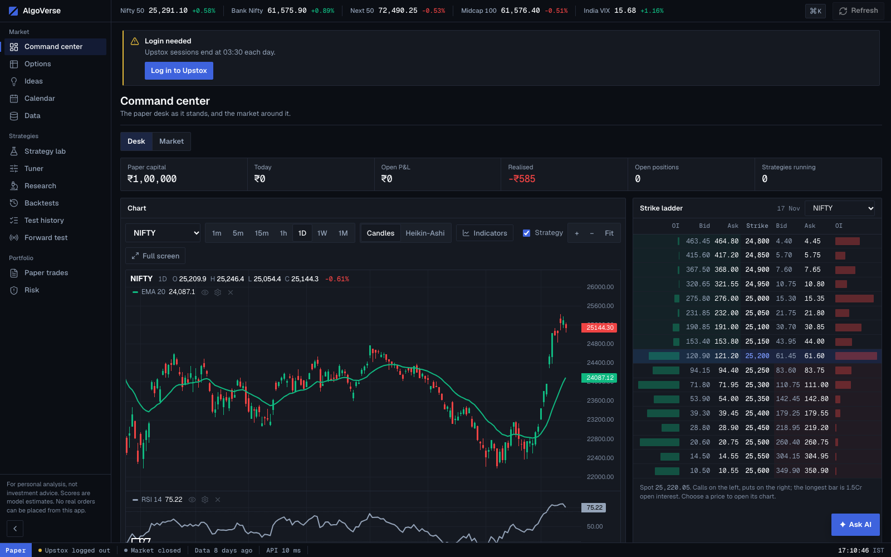

It covers the whole loop from idea to paper position:

- **Market**: a command center with live quotes, a strike ladder, charts with indicators, ranked trade ideas and an event calendar.
- **Strategies**: a no-code strategy lab, a parameter tuner (grid, random and Bayesian search), research studies, backtests with trade-by-trade replay, and forward tests with drift gates.
- **Portfolio**: paper trades and a risk monitor (Greeks, exposure, limits, stress tests).
- **AI**: a local model (Ollama) that critiques strategies, designs new ones and answers questions about the desk.

> For personal analysis only, not investment advice. AlgoVerse paper trades; it never places real orders.

## Screenshots

### Market

**Command center**: paper desk summary, index chart with indicators and the strike ladder.


**Options**: chain analytics for one underlying and expiry: IV, put-call ratio, max pain, open interest and the volatility smile, plus an AI news brief.

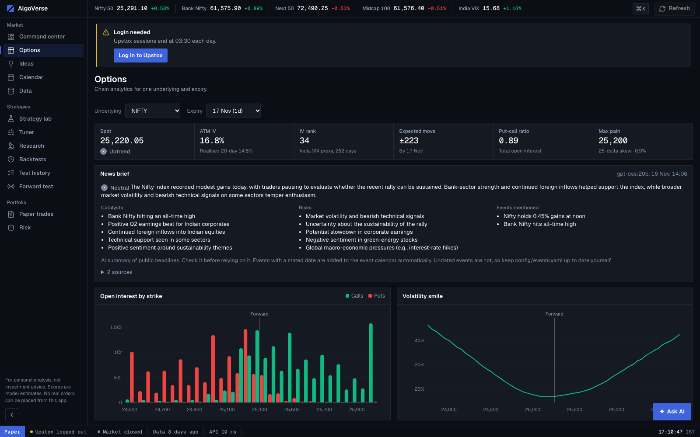

**Ideas**: trades ranked from the latest option chains, each with an AI review and payoff.

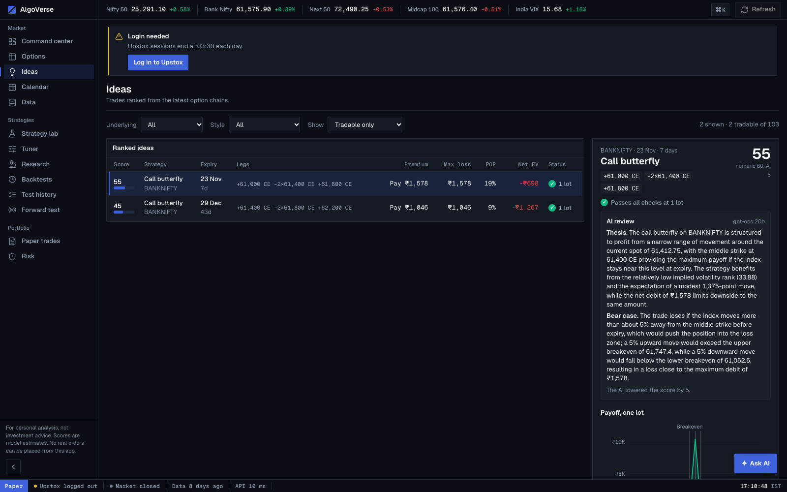

**Calendar**: holidays, expiries and market events, with how the AI reads each one.

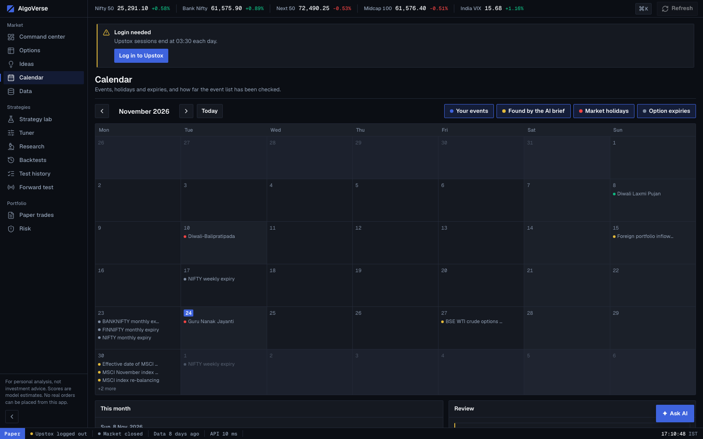

**Data**: what history is stored, and loaders that fetch more from Upstox.

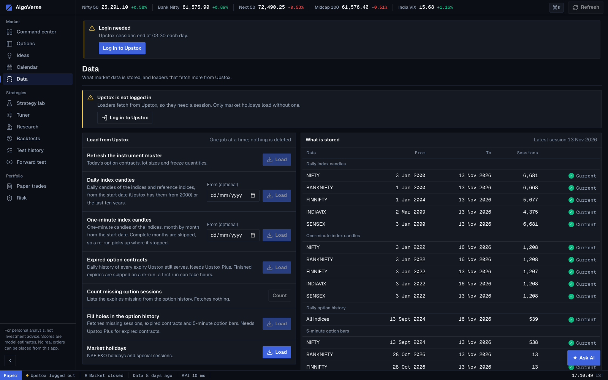

### Strategies

**Strategy lab**: build strategies, test them and rank them on unseen data.

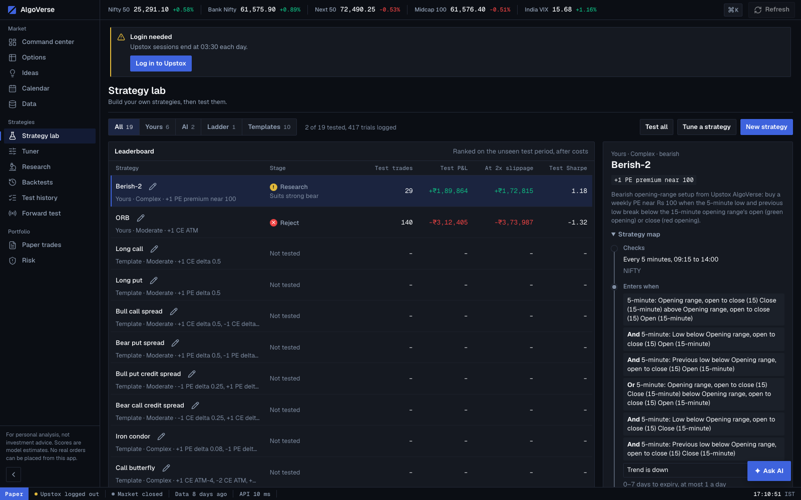

**Tuner**: change one setting at a time and keep only what holds up on unseen sessions.

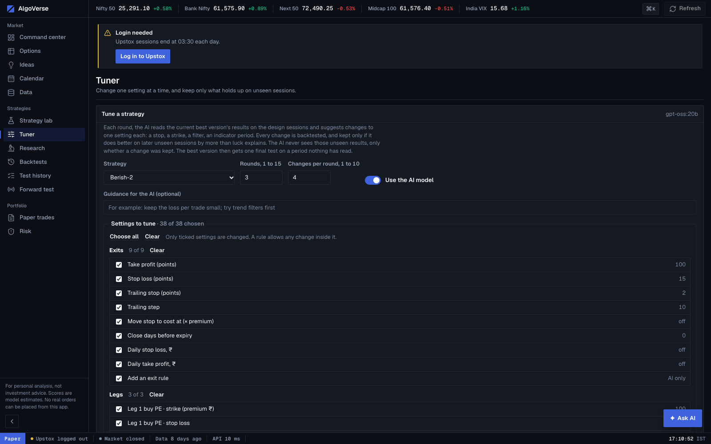

**Research**: how the indices behave: time of day, volatility, correlations, gaps, pairs and an ML signal.

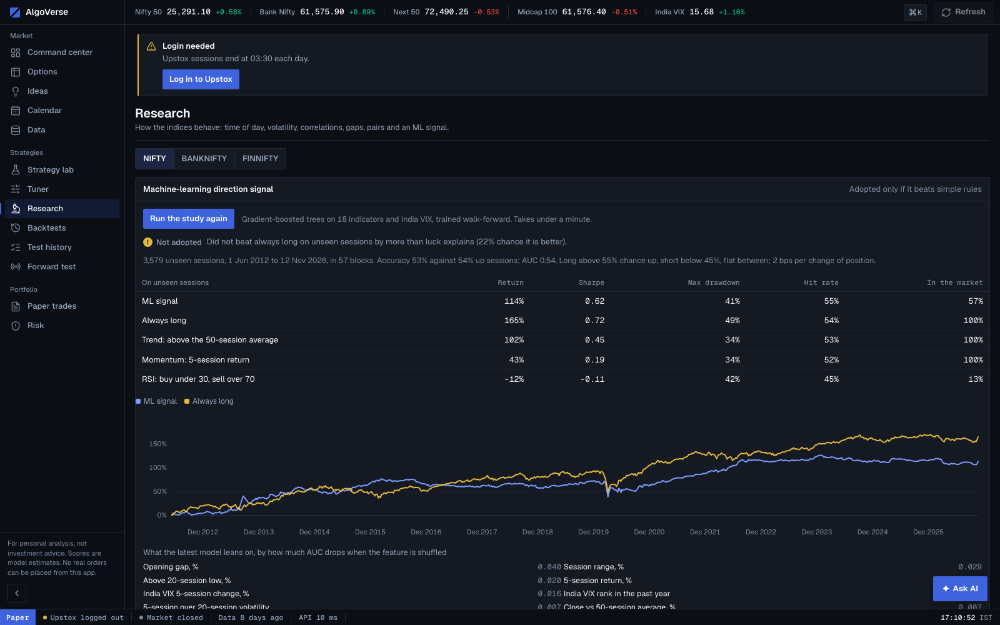

**Backtests**: walk-forward and single-window backtests with verdicts and cumulative P&L.

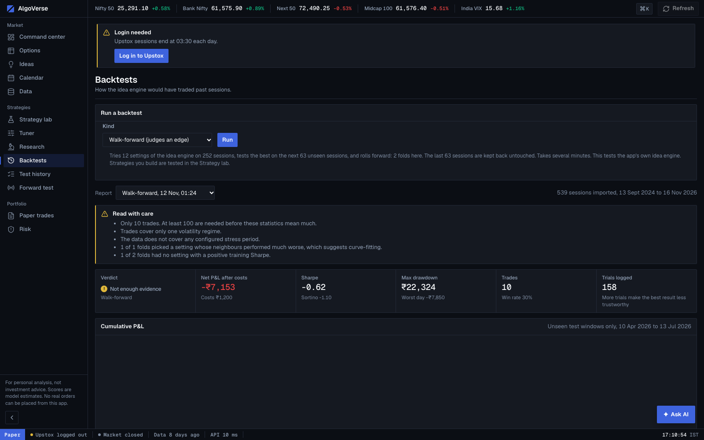

**Test history**: every test, tuner check and ladder step, newest first.

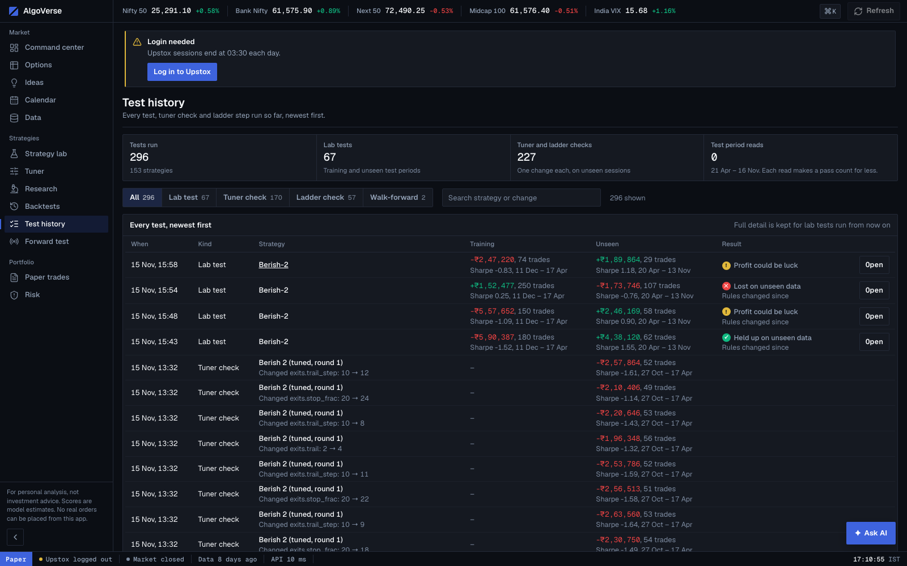

**Forward test**: locked configurations paper trading on live data.

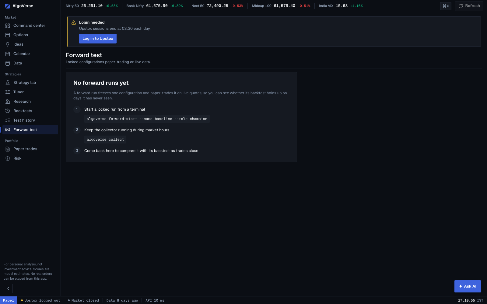

### Portfolio

**Paper trades**: positions, fills and P&L after costs.

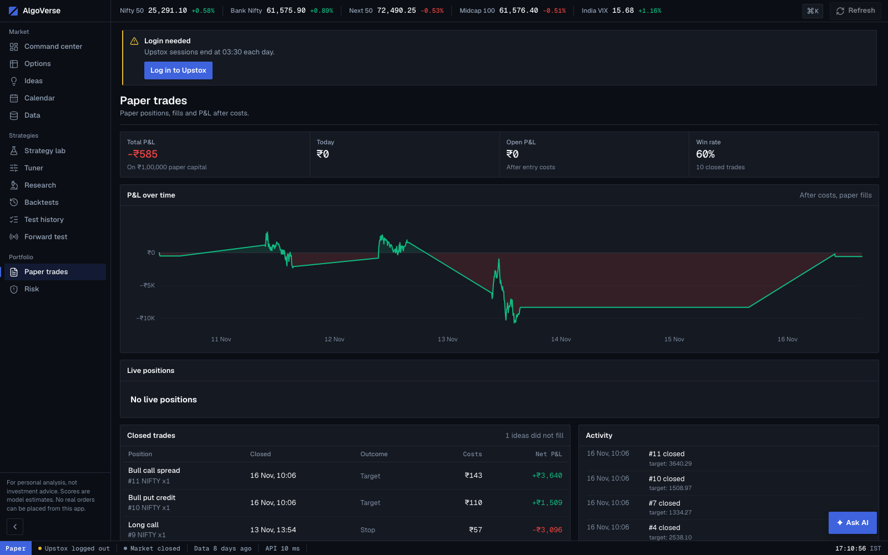

**Risk**: limits, Greeks, stress tests and exposure across open positions.

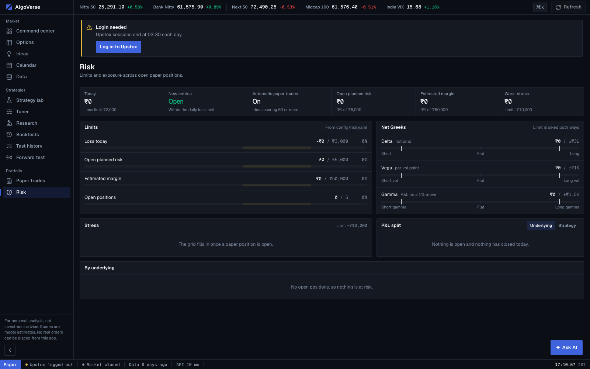

## Getting started

### 1. Requirements

- [Docker Desktop](https://www.docker.com/products/docker-desktop/)
- An [Upstox developer app](https://account.upstox.com/developer/apps) (API key and secret). Upstox Plus is needed only for importing expired contracts.
- Optional: [Ollama](https://ollama.com) running on the host with the model in `config/ai.yaml` (`ollama pull gpt-oss:20b`) for the AI features.

### 2. Configure

```bash
cp .env.example .env
```

Fill in `ALGOVERSE_UPSTOX_API_KEY` and `ALGOVERSE_UPSTOX_API_SECRET`. On your Upstox app, set the redirect URL to exactly:

```
http://127.0.0.1:8000/auth/callback
```

Everything else (universe, risk limits, costs, scoring, events) lives in `config/*.yaml`. The folder is mounted into the containers, so edits apply without a rebuild.

### 3. Start

```bash
docker compose up --build -d --remove-orphans
```

Open **http://127.0.0.1:8000** and click **Log in to Upstox**. Upstox sessions end at 03:30 each day, so you log in once per day.

This starts four services:

| Service    | What it does                                                    |
| ---------- | --------------------------------------------------------------- |
| `frontend` | The dashboard (nginx), forwarding `/api` and `/auth` to the backend |
| `backend`  | The API, login flow and paper trading                           |
| `collect`  | Saves option-chain snapshots and refreshes history on a schedule |
| `stream`   | Keeps the live feed connected in market hours and stores every tick |

The app has no login of its own, so it is published on localhost only. Keep it that way.

### 4. Load history

Backtests need data. After logging in, run any of these:

```bash
docker compose run --rm backend backfill            # daily index candles (default: 10 years)
docker compose run --rm backend backfill-minutes    # one-minute index candles for intraday rules
docker compose run --rm backend history-upstox      # expired option contracts (needs Upstox Plus)
docker compose run --rm backend history-fill --plan # count missing expiries before filling them
```

You can also import NSE bhavcopy files you downloaded with `history-import <files>`.

### 5. Use it

1. **Strategy lab**: build a strategy (legs, entry and exit rules, indicators) and backtest it.
2. **Tuner**: search its parameters, then open any tuned version's full backtest.
3. **Backtests**: inspect trades, open a trade's strike chart and replay its day.
4. **Forward test**: lock a configuration and let it paper trade live, gated against its backtest.
5. **Paper trades / Risk**: watch positions, P&L and Greeks.

Press <kbd>⌘K</kbd> anywhere for the command palette.

## Command line

Every command runs inside the backend image:

```bash
docker compose run --rm backend --help
docker compose run --rm backend forward-status
docker compose run --rm backend paper-status
docker compose run --rm backend walk-forward
```

## Local development

Backend (Python 3.11+):

```bash
python3.11 -m venv .venv && source .venv/bin/activate
pip install -e ".[dev]"
algoverse serve          # API on http://127.0.0.1:8000
pytest                   # tests
ruff check .             # lint
```

Frontend (Node 24), with hot reload, proxying `/api` and `/auth` to the backend:

```bash
cd frontend
npm install
npm run dev              # http://127.0.0.1:5173
```

Set `ALGOVERSE_API` to point the dev server at a different backend. Locally, data is written to `data/` (set by `ALGOVERSE_DATA_DIR`); in Docker it lives in the `algoverse-data` volume.

## Project layout

```
backend/algoverse/   API, brokers, data, backtest engine, lab, risk, AI
frontend/src/        React + Vite dashboard
config/              YAML settings (universe, risk, costs, scoring, AI, ...)
tests/               pytest suite
```
